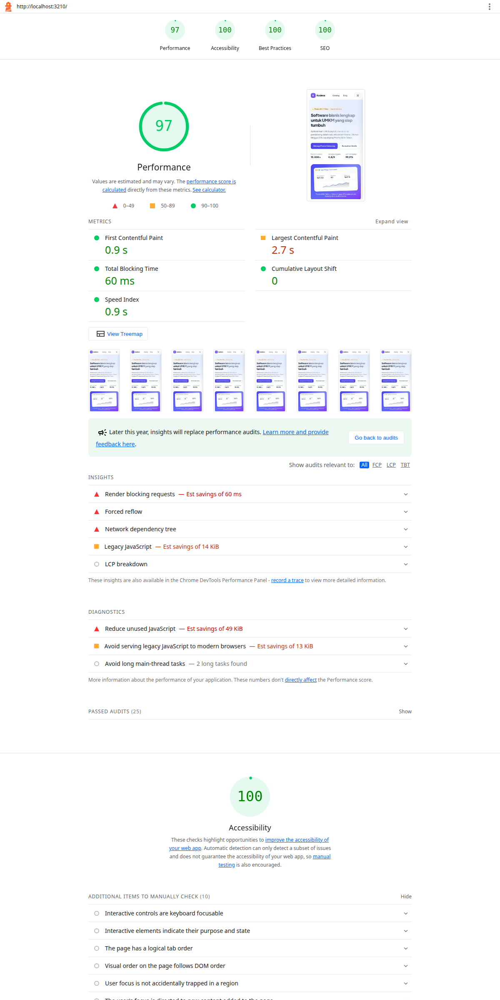

# Kodeva

Situs demo untuk brand fiktif **Kodeva**: landing page campaign, blog ber-CMS, dan mini
marketplace lisensi software (kasir, HR & payroll, add-on).

- **Live demo:** `https://kodeva-dev.vercel.app`
- **Repositori:** `https://github.com/wicaksana94/kodeva`
- **Studio CMS (marketing):** `https://kodeva-dev.vercel.app/studio`
- **AI log:** lihat [`AI_LOG.md`](./AI_LOG.md)
- **Laporan Lighthouse:** lihat [`docs/lighthouse/`](./docs/lighthouse) (JSON + HTML + screenshot)
- **Waktu pengerjaan:** 17 Oktober 2026 — 5 sesi kerja (09:45–11:24, 12:39–14:30,
  15:00–16:30, 18:30–20:00, 21:00–22:00 WIB), total **7 jam 30 menit**. Rincian per
  milestone ada di commit history dan [`AI_LOG.md`](./AI_LOG.md).

> Semua konten (produk, harga, testimoni, artikel, kontak) adalah data dummy untuk keperluan
> skill test. Tidak ada transaksi/ pembayaran sungguhan.

---

## 1. Requirement brief → di mana implementasinya

### A. Landing page + blog dengan CMS (editable oleh marketing)

| Requirement                               | Implementasi                                                                                                                                                     |
| ----------------------------------------- | ---------------------------------------------------------------------------------------------------------------------------------------------------------------- |
| Hero, unggulan, testimoni, lead form, FAQ | `src/app/(site)/page.tsx` — seluruh copy & item berasal dari CMS (`getLandingContent()`), fallback lokal bila CMS kosong                                         |
| Blog list + halaman detail                | `src/app/(site)/blog/page.tsx`, `src/app/(site)/blog/[slug]/page.tsx` (Portable Text, kategori, produk terkait, pagination)                                      |
| CMS-nya bisa dipakai non-teknis           | Sanity Studio ter-embed di `/studio` — form berlabel Bahasa Indonesia + group tab (Hero, Testimoni, FAQ, dll.) di `src/sanity/schemaTypes/`                      |
| Perubahan muncul cepat                    | On-demand revalidation: webhook Sanity → `/api/revalidate` → `revalidateTag('landing'/'posts', 'max')`; jaring pengaman TTL 10 menit bila webhook tidak dipasang |
| Lead form (bonus pendukung)               | `POST /api/leads` — validasi Zod, honeypot, minimum waktu isi, rate limit per IP; lead tersimpan ke Sanity (atau `.data/leads.jsonl` di mode lokal)              |

### B. Mini marketplace (frontend only + mock payment)

| Requirement                          | Implementasi                                                                                                                                        |
| ------------------------------------ | --------------------------------------------------------------------------------------------------------------------------------------------------- |
| Katalog ≥6 produk                    | 8 produk di `src/lib/catalog/data.ts`; katalog dengan filter kategori di `/katalog`                                                                 |
| Halaman detail + 3 paket             | `/produk/[slug]` — paket Basic/Pro/Business, galeri mockup, keunggulan, JSON-LD Product                                                             |
| Promo dengan kuota lintas baris      | Model kuota di-share **per produk** (total lisensi semua paket promo produk yang sama), bukan per paket — lihat `src/lib/cart/logic.ts`             |
| Keranjang persist                    | Zustand + `localStorage` (`kodeva:cart`), rehidrasi aman (`skipHydration`) + rekonsiliasi saat memuat (produk hilang, duplikat, qty melebihi kuota) |
| Checkout + mock payment sukses/gagal | `/checkout` + `POST /api/mock-payment`; **harga & kuota dihitung ulang di server** — keranjang yang kedaluwarsa ditolak `409`                       |
| Aturan uji gagal deterministik       | Email pelanggan yang diawali `fail` (contoh `fail@bisnis.com`) **selalu gagal**; email lain selalu berhasil                                         |

### C. Marketing & growth

| Requirement                | Implementasi                                                                                                                                                                     |
| -------------------------- | -------------------------------------------------------------------------------------------------------------------------------------------------------------------------------- |
| Lighthouse mobile ≥80      | **Performance 96–99** di 4 halaman utama (A11y/Best Practices/SEO = 100) — bukti di `docs/lighthouse/`                                                                           |
| Tracking GA4 / dataLayer   | `view_item`, `add_to_cart`, `begin_checkout` (format GA4 ecommerce), + `cta_click` (custom) di `src/lib/analytics/datalayer.ts`; dedup agar tidak dobel saat re-render / remount |
| Atribusi UTM               | Last-touch, disimpan (`kodeva:attribution`, TTL 30 hari), ikut terkirim di payload lead & checkout                                                                               |
| Bukti event untuk reviewer | Buka halaman mana pun dengan `?debug=events` → panel dataLayer tampil di kiri bawah                                                                                              |

### Deliverable

- [x] Git repo dengan riwayat commit granular (bukan satu commit besar)
- [x] README.md (dokumen ini)
- [x] AI_LOG.md
- [x] Link deploy — `https://kodeva-dev.vercel.app`

---

## 2. Coba cepat (demo flow untuk reviewer)

1. **Landing** `/` — perhatikan CTA, produk unggulan (harga promo + sisa kuota), FAQ.
2. **Tracking** — buka `/katalog?debug=events`, klik produk, tambah ke keranjang, lalu lihat
   panel event: `view_item`, `add_to_cart`, dst.
3. **UTM** — buka `/katalog?utm_source=google&utm_medium=cpc&utm_campaign=promo-akhir-tahun`,
   lanjut sampai checkout (event + payload memuat atribusi).
4. **Promo lintas baris** — di `/produk/kasir-prima`, tambahkan **Pro** beberapa lisensi, lalu
   **Business**; perhatikan kuota 87 lisensi terbagi dari dua baris dan total harga promo benar.
5. **Checkout sukses** — isi data apa pun (email bebas), bayar → pesanan `KV-...` + rincian.
6. **Checkout gagal** — ulangi dengan email `fail@bisnis.com` → panel gagal + tombol coba lagi.
7. **Keranjang nakal** — tambah item, ubah `kodeva:cart` di localStorage devtools (mis. produk
   asing / qty 999), reload → keranjang direkonsiliasi dengan notifikasi.
8. **State simulasi katalog** — `/katalog?mock=empty`, `?mock=slow`, `?mock=fail`
   (error boundary dengan tombol reset).
9. **Blog** — `/blog`, buka artikel, perhatikan JSON-LD + artikel terkait produk.
10. **CMS** — buka `/studio`, ubah judul hero → publish → landing berubah dalam detik
    (setelah webhook terpasang).
11. **Region (bonus)** — dropdown bendera di navbar: Indonesia aktif secara default; pilih
    Malaysia/Singapore → pop-up "segera hadir".

---

## 3. Menjalankan secara lokal

Prasyarat: **Node.js ≥ 24**, **pnpm 11**.

```bash
pnpm install
cp .env.example .env.local   # opsional — semua kosong pun situs tetap jalan
pnpm dev                     # http://localhost:3000
```

### Mode tanpa kredensial (default reviewer)

Situs berjalan penuh **tanpa** Sanity: konten landing & artikel memakai fallback lokal
(`src/sanity/fallback.ts`), lead tersimpan ke `.data/leads.jsonl`. Ini disengaja agar build &
demo tidak pernah gagal karena env. Route `/studio` mendeteksi kondisi ini dan menampilkan
panduan setup langkah demi langkah (bukan error mentah).

### Mode dengan Sanity

Isi `.env.local`:

```bash
NEXT_PUBLIC_SANITY_PROJECT_ID="xxxxxxx"
NEXT_PUBLIC_SANITY_DATASET="production"
SANITY_API_READ_TOKEN=""            # opsional (dataset publik tidak butuh)
SANITY_API_WRITE_TOKEN="sk..."      # untuk lead & seed
SANITY_REVALIDATE_SECRET="rahasia"  # untuk webhook
NEXT_PUBLIC_SITE_URL="http://localhost:3000"
```

Lalu isi konten awal:

```bash
pnpm seed    # idempotent: menulis landingPage, kategori, dan 3 artikel demo ke Sanity
```

Agar Studio lokal bisa dipakai login, tambahkan `http://localhost:3000` di **CORS origins**
project (sanity.io/manage → API) dengan opsi _Allow credentials_. Tanpa langkah itu situs tetap
berjalan, tetapi Studio di browser akan gagal memuat data.

### Skrip yang tersedia

| Skrip                                    | Fungsi                                |
| ---------------------------------------- | ------------------------------------- |
| `pnpm dev` / `pnpm build` / `pnpm start` | Next.js dev / build / produksi        |
| `pnpm test`                              | Unit test (Vitest) — **53 test**      |
| `pnpm typecheck`                         | `tsc --noEmit`                        |
| `pnpm lint`                              | ESLint (bersih tanpa error/warning)   |
| `pnpm format`                            | Prettier (termasuk plugin Tailwind)   |
| `pnpm seed`                              | Seed konten Sanity dari data fallback |

---

## 4. Keputusan teknis (dan alasannya)

**Stack & alasan singkatnya:** **Next.js 16 (App Router) + TypeScript** — satu framework untuk
situs statis/cepat + API routes dalam satu deploy (brief fullstack, TS wajib), dan Cache
Components-nya pas untuk kebutuhan revalidasi konten CMS; **Sanity** — CMS headless dengan editing
real-time, Studio dapat di-embed satu deploy, dan data terstruktur (bukan sekadar WYSIWYG) sehingga
marketing tetap memilih dari opsi valid; **Tailwind CSS 4** — UI konsisten dengan iterasi cepat
(elemen kustom kecil, tanpa perlu design system berat); **Zustand** — state keranjang minimalis
dengan `persist` + rehidrasi terkontrol (dibanding Redux: boilerplate jauh lebih kecil untuk
kebutuhan satu store); **Zod** — satu schema validasi dipakai client _dan_ server; **Vitest** —
fungsi murni (kuota/harga/UTM) bisa diuji langsung tanpa DOM.

### 4.1 Next.js 16 App Router dengan Cache Components + on-demand revalidation

Konten CMS dibungkus `"use cache"` + `cacheLife({stale: 300, revalidate: 600})` + `cacheTag`
(`landing`, `posts`, `post-<slug>`). Halaman ter-prerender statis (cepat, murah), lalu webhook
Sanity memanggil `revalidateTag(tag, 'max')` sehingga publish **langsung** tampil. TTL 10 menit
adalah jaring pengaman bila webhook mati — sedangkan di development refresh dipercepat
(`revalidate` 30 detik) karena webhook tidak bisa memanggil `localhost`, sehingga perubahan dari
Studio tampil tanpa restart. Nilai dev sengaja tetap di atas ambang prerender Next
(`stale`/`expire` ≥ 5 menit) agar prerender dan App Shell tetap valid; `cacheLife` ditulis literal
agar tetap dapat dianalisis statis. Rute detail produk/artikel (`/produk/[slug]`, `/blog/[slug]`)
di-opt-out dari validasi instant (`export const instant = false`) karena seluruh kontennya
bergantung pada URL dan semua slug sudah diprerender. Konsekuensi yang diterima secara sadar:
route dinamis ber-`searchParams` (`/katalog`, `/blog?page=`) memakai pola static shell +
`<Suspense>` untuk bagian dinamisnya.

### 4.2 Konten CMS, data domain di kode

Copy marketing sepenuhnya di CMS (termasuk banner + teks promo mingguan, produk mockup hero,
statistik, foto testimoni, dan label CTA di landing); namun **produk, harga, dan kuota promo** sengaja hidup di
`src/lib/catalog/data.ts` (typed). Alasannya: integritas data transaksi tidak cocok
diedit-bebas dari CMS tanpa validasi bisnis; schema Sanity untuk landing/artikel memakai
`options.list` yang di-generate dari file yang sama sehingga marketing tetap memilih dari daftar
valid. Ini juga membuat fallback, seed, dan server-validation memakai satu sumber kebenaran.

### 4.3 Harga & kuota: dipercaya hanya di server

`/checkout` menampilkan estimasi dari keranjang (Zustand), tapi `POST /api/mock-payment`
**menghitung ulang** semua harga dari katalog dan memvalidasi ulang kuota promo; permintaan yang
melebihi kuota dijawab `409` dengan pesan actionable. Logika kuota lintas baris ada di fungsi
murni `src/lib/cart/logic.ts` — dipakai bersama oleh store, UI, dan server, dan ditutup
22 unit test.

### 4.4 Rekonsiliasi keranjang yang tahan data lokal usang

Data localStorage bisa kedaluwarsa (harga/kuota/produk berubah). Saat rehidrasi, keranjang:
membuang produk yang tidak dikenal, menggabungkan baris duplikat, membatasi quantity ke rentang
wajar, dan memotong kelebihan kuota promo (prioritas baris yang lebih dulu) — dengan notifikasi
ke pengguna. Detail di `reconcileCartItems()`.

### 4.5 Tracking yang tidak dobel + dapat dibuktikan

Event GA4 dikirim via `window.dataLayer.push` (siap disambungkan ke GTM/GA4). `view_item` dan
`begin_checkout` dilindungi dedup (registry + penanda `sessionStorage` 30 menit) agar tidak
terkirim ulang saat React re-render/re-mount. Reviewer bisa melihat event aslinya lewat
`?debug=events` tanpa perlu membuka GTM.

### 4.6 Alur gagal yang bisa diuji (failure path deterministik)

Mock payment memakai aturan sederhana yang dapat diprediksi reviewer: email diawali `fail` ⇒
gagal. Katalog punya `?mock=empty|slow|fail` untuk melatih empty state, Suspense/skeleton, dan
error boundary. Lead API memiliki honeypot + minimum waktu pengisian + rate limit 5/10 menit
per IP (in-memory — cukup untuk demo; produksi perlu penyimpanan bersama).

### 4.7 Aksesibilitas & performa sebagai bagian definisi "selesai"

Iterasi Lighthouse (`docs/lighthouse/`) dipakai untuk memperbaiki kontras teks kecil dan ARIA
(hasil akhir: Performance **96–99**, Accessibility/Best Practices/SEO **100** di 4 halaman
utama). Rincian iterasi (termasuk kesalahan yang ditemukan) ada di `AI_LOG.md` §4–§5.

### 4.8 Batasan yang diketahui (jujur)

- **Soft-404 pada route dinamis**: `/blog/<slug-tak-dikenal>` menampilkan halaman 404 dengan
  status HTTP 200. Ini konsekuensi streaming/PPR (status terkirim bersama shell sebelum lookup
  konten selesai). `dynamicParams = false` bisa memaksa 404 keras tapi akan memblokir artikel
  baru yang di-publish tanpa rebuild — trade-off yang dipilih demi alur publish yang instan.
- Rate limit in-memory tidak cocok multi-instance (produksi: Redis/Upstash).
- Lead & order tidak dikirim ke CRM/email — hanya tersimpan (Sanity/JSONL) dan log server.
- Uang: semua harga rupiah bilangan bulat; tanpa pajak/PPN (di luar scope brief).

---

## 5. Asumsi atas hal yang ambigu

1. **Harga & periode:** semua harga rupiah bulat, periode lisensi 1 bulan, tanpa PPN/biaya lain.
   "Harga coret" hanya berasal dari harga promo di data produk.
2. **Model kuota promo:** brief menyebut kuota berlaku terhadap _total lisensi produk yang sama_
   lintas baris/paket. Diimplementasikan sebagai satu kuota per produk yang dipakai bersama semua
   paket promonya (angka dummy di `src/lib/catalog/data.ts`).
3. **"Screenshot fitur":** brand fiktif, sehingga tidak ada aplikasi nyata untuk di-screenshot —
   dipakai mockup UI ber-brand (dirender CSS) yang tetap memperlihatkan tampilan fitur di galeri
   produk.
4. **Checkout:** brief meminta nama + email; ditambah WhatsApp & perusahaan (opsional) karena
   penjualan ke UMKM lazim membutuhkan kontak WA — hanya email yang memicu aturan gagal
   deterministik (`fail@...`).
5. **Tanpa backend:** lead & order demo disimpan sebagai file/JSONL + log; rencana penyimpanan
   produksi ada di §7.
6. **Caching:** target "perubahan CMS tampil tanpa deploy" dicapai via webhook revalidasi; TTL
   10 menit adalah jaring pengaman bila webhook belum dikonfigurasi (§4.1).
7. **Bahasa & wilayah:** UI Bahasa Indonesia. Ekspansi MY/SG yang disebut tim marketing belum
   termasuk scope wajib — dicatat sebagai roadmap i18n di §6.
8. **Waktu & infrastruktur:** tanggal konten dalam zona WIB; rate limit in-memory dianggap cukup
   untuk demo satu instans.

## 6. Status pekerjaan

### Selesai (seluruh requirement wajib brief)

- **A. Landing + blog + CMS:** semua section landing dapat diedit marketing (termasuk produk
  unggulan, testimoni, FAQ, dan copy), lead form tersimpan & terlihat di Studio, blog dengan
  pagination + slug, draft/publish, penautan produk, revalidasi tanpa deploy.
- **B. Mini marketplace:** 8 produk + filter kategori (tiap card punya tombol CTA), detail dengan paket Basic/Pro/Business,
  promo + kuota lintas baris, keranjang persisten, checkout dengan simulasi sukses/gagal,
  state loading/error/kosong, mobile-friendly.
- **C. Marketing:** Lighthouse mobile Performance **97** di landing (target ≥80); event GA4
  (`view_item`, `add_to_cart`, `begin_checkout`, `cta_click`) terbukti terkirim via
  `?debug=events` dan tidak dobel saat re-render — termasuk klik tombol produk unggulan di
  landing (`cta_click` `featured-product-*`); UTM last-touch 30 hari ikut di payload lead
  dan order.
- **Dokumentasi:** README ini + `AI_LOG.md` + 53 unit test + laporan Lighthouse di
  `docs/lighthouse/`.

### Bonus (opsional) — sebagian tercapai, sisanya masuk roadmap

- ✔ **Test otomatis untuk logika penting** (kuota & total harga — bonus #7) dan **filter kategori
  tercermin di URL** (`/katalog?kategori=kasir` dapat dibagikan — bagian bonus #2).
- ✘ Belum: urutkan harga/pencarian di katalog, durasi langganan + tabel perbandingan paket,
  pengaturan urutan/visibilitas section landing dari CMS, penjadwalan promo, kode voucher,
  preview draft khusus (Sanity menyediakan draft secara bawaan).

### Belum dikerjakan

- **Link deploy + akun CMS demo** untuk reviewer — langkah terakhir pengumpulan (§10); aplikasi
  sudah siap deploy.
- Integrasi backend marketplace (§7) dan item bonus di atas.

### Kalau ada waktu 1 minggu lagi (urutan prioritas)

1. **Deploy & operasional:** Vercel + Sanity produksi, webhook, error monitoring (Sentry), rate
   limit berbasis Redis (bukan in-memory).
2. **Backend marketplace sesuai §7** (orders + payment gateway sandbox, webhook tervalidasi,
   pengiriman lisensi) — pondasi nilai jual sebenarnya.
3. **Bonus katalog & detail:** sortir harga + pencarian dengan state di URL, durasi
   bulanan/tahunan, tabel perbandingan paket, kode voucher.
4. **CMS lanjutan:** urutan/visibilitas section + penjadwalan promo dari CMS, preview draft.
5. **i18n ID/EN + mata uang MYR/SGD** untuk ekspansi tim regional.
6. **E2E test (Playwright)** untuk alur beli + audit aksesibilitas otomatis di CI.

## 7. Rencana menghubungkan marketplace ke backend (di luar scope test ini)

Bagian marketplace sengaja frontend-only. Berikut rancangan produksinya — memanfaatkan kode yang
sudah ada: logika harga & kuota di `src/lib/cart/logic.ts` dipakai ulang apa adanya di server.

### 7.1 Endpoint yang dibutuhkan

| Endpoint                                       | Fungsi                                                                                                                                                                                       |
| ---------------------------------------------- | -------------------------------------------------------------------------------------------------------------------------------------------------------------------------------------------- |
| `GET /api/products`, `GET /api/products/:slug` | katalog & detail dengan kuota promo real-time (cache TTL pendek)                                                                                                                             |
| `POST /api/orders`                             | buat order `pending`: terima `{ items, customer, attribution }`, hitung ulang harga & validasi kuota **dari database**, lakukan reservasi kuota (7.3), kembalikan `orderId` + jumlah tagihan |
| `POST /api/orders/:id/pay`                     | inisiasi pembayaran ke gateway; amount diambil dari order di DB, bukan dari client                                                                                                           |
| `GET /api/orders/:id`                          | status order untuk halaman hasil pembayaran                                                                                                                                                  |
| `POST /api/webhooks/payment`                   | callback gateway (7.2)                                                                                                                                                                       |
| `POST /api/orders/:id/cancel`                  | batalkan order pending + lepas reservasi kuota                                                                                                                                               |
| `POST /api/leads`                              | sudah ada; di produksi menyimpan ke DB dan meneruskan ke CRM/email tim marketing                                                                                                             |

### 7.2 Alur payment gateway yang aman (contoh: Midtrans/Xendit)

1. **Order `pending`** dibuat server-side; `amount` tersimpan di DB dan tidak dapat dipengaruhi
   client. Order memegang **reservasi kuota**.
2. **Inisiasi pembayaran** ke gateway memakai `order_id` internal sebagai idempotency key; client
   hanya menerima token/redirect.
3. **Webhook** masuk ke `POST /api/webhooks/payment` dengan dua lapis verifikasi:
   - **validasi signature** (mis. SHA-512 `order_id + status_code + gross_amount + server_key`),
   - **validasi amount** harus sama persis dengan `amount` order — payload mentah tidak pernah
     dipercaya.
4. **Pemrosesan idempotent**: dikunci per `order_id` (unique constraint di DB) sehingga webhook
   duplikat/retry tidak menggandakan lisensi. Status bergerak
   `pending → paid → fulfilled`, dengan cabang `failed` / `expired` / `refunded`.
5. **Halaman hasil** memantau `GET /api/orders/:id` (polling singkat) dengan tombol "coba lagi"
   yang membuat tautan pembayaran baru untuk order yang sama.
6. **Rekonsiliasi harian**: order `pending` yang melewati batas waktu otomatis di-`expire` dan
   reservasi kuotanya dilepas.

### 7.3 Menjaga kuota lisensi promo tetap akurat

- **Satu sumber kebenaran = database** (tabel `promo_quotas(product_id, total, used)` +
  `order_items`). Keranjang client hanya untuk UX — server menghitung ulang saat
  `POST /api/orders`, persis seperti mock payment sekarang.
- **Decrement atomik** dengan syarat batas:
  `UPDATE promo_quotas SET used = used + :qty WHERE product_id = :id AND used + :qty <= total` →
  jika 0 baris ter-update berarti kuota habis ⇒ tolak `409` (menggantikan cek in-memory yang ada
  sekarang). Tidak ada read-then-write yang racy.
- **Reservasi berbatas waktu** untuk order `pending` (tabel `quota_holds` atau kolom status),
  dilepas otomatis saat order gagal/expired. Mencegah oversell ketika dua pembeli checkout
  bersamaan.
- **Anti-double-spend**: pembuatan lisensi idempotent per `order_id`; refund mengembalikan kuota
  sesuai kebijakan bisnis.
- Penjadwalan promo dari CMS (bonus) menulis ke tabel yang sama sehingga tetap satu hitungan.

### 7.4 Pengiriman lisensi setelah pembayaran berhasil

1. Transisi `paid` memicu job pembuatan lisensi yang **idempotent** (unique `order_item_id`):
   generate kode (mis. `KODV-<PRODUK>-<ACAK>`), simpan terenkripsi bersama tanda tangan untuk
   keperluan aktivasi.
2. Kirim email transaksional berisi kode + tautan aktivasi; sediakan juga halaman akun agar
   pembeli bisa melihat lisensinya tanpa bergantung pada email.
3. Kegagalan pengiriman masuk retry dengan backoff + dead-letter queue; order tetap `paid`
   karena lisensi sudah dibuat — hanya notifikasinya yang tertunda.
4. Untuk langganan: simpan `expires_at` per lisensi + job pengingat perpanjangan dan suspensi
   otomatis saat kedaluwarsa.

## 8. Struktur proyek (ringkas)

```
src/
  app/
    (site)/            # layout dengan header/footer; halaman publik
      page.tsx         # landing (CMS-driven)
      katalog/ produk/[slug]/ keranjang/ checkout/
      blog/ [slug]/
      error.tsx (katalog)  not-found.tsx
    studio/[[...tool]]/ # Sanity Studio ter-embed
    api/               # leads, mock-payment, revalidate
    sitemap.ts robots.ts opengraph-image.tsx
  components/          # cart, checkout, marketplace, blog, marketing, site, seo, analytics
  lib/
    catalog/           # data + tipe produk (sumber kebenaran)
    cart/logic.ts      # harga & kuota lintas baris (fungsi murni) + tests
    analytics/         # dataLayer (GA4), UTM, penanda checkout
    store/             # zustand: cart, ui, toasts
    leads/ checkout/   # schema zod + penyimpanan + rate limit
    sanity/            # loader gambar
  sanity/              # client, queries, content (cache), fallback, schemaTypes
scripts/seed.ts
docs/lighthouse/       # bukti audit (JSON/HTML/PNG)
```

---

## 9. Untuk tim marketing (cara pakai CMS)

1. Buka `/studio` (login sekali dengan akun Sanity yang diundang).
2. **Landing Page** (singleton): edit hero (eyebrow, judul, gambar banner, statistik singkat,
   produk mockup saat tanpa gambar), **teks promo mingguan** (nama campaign + label/catatan
   promo — selalu tampil di hero, dengan atau tanpa banner), produk unggulan
   (pilih dari daftar produk valid + label tombol), testimoni (teks + foto opsional — kosong =
   inisial nama), FAQ, dan copy form lead — semua berlabel Bahasa Indonesia, dikelompokkan per
   seksi. Klik **Publish** → webhook memicu revalidasi → perubahan tampil dalam hitungan detik (di
   localhost tanpa webhook: ≤ ±1 menit — TTL development).
3. **Artikel Blog**: buat draft → isi judul/ringkasan/kategori/body (mendukung heading, kutipan,
   list, tautan, gambar) → pilih produk terkait → **Publish**.
4. **Lead yang masuk** tampil sebagai dokumen `Lead` di Studio (nama, kontak, UTM asal) — siap
   ditarik tim sales.
5. Butuh bantuan? Semua field penting punya deskripsi singkat di panel field.

---

## 10. Deploy

### Vercel

```bash
pnpm dlx vercel link        # pilih scope & project
pnpm dlx vercel env add NEXT_PUBLIC_SANITY_PROJECT_ID
# ...ulangi untuk semua env di .env.example (kecuali NEXT_PUBLIC_SITE_URL, isi dengan domain final)
pnpm dlx vercel --prod
```

### Sanity

1. `pnpm dlx sanity login` → `pnpm dlx sanity projects create` (atau pakai project yang ada),
   lalu pastikan `projectId` di env Vercel sudah benar. Dataset `production` dibuat otomatis.
2. Tambahkan domain ke **CORS origins** (sanity.io/manage → API → CORS): `http://localhost:3000`
   (saat pengembangan) dan `https://<domain-vercel>` (produksi). Centang **Allow credentials**
   agar login Studio dari origin tersebut bekerja.
3. Isi konten: jalankan `pnpm seed` (lokal, dengan env produksi) atau salin dokumen lewat Studio.
4. **Webhook revalidasi** (sanity.io/manage → API → Webhooks):
   - URL: `https://<domain-vercel>/api/revalidate`
   - Method: POST, HTTP header secret (`sanity-webhook-signature`)
   - Secret: sama dengan env `SANITY_REVALIDATE_SECRET`
   - Trigger: Create + Update + Delete, filter: kosongkan (tag dihitung di route)
5. **Akun CMS demo untuk reviewer:** undang email reviewer sebagai member project Sanity
   (hak edit konten) sehingga mereka dapat mencoba mengubah konten di `/studio`.

---

## 11. Pengujian

- 53 unit test (`pnpm test`) pada logika yang paling mudah salah:
  - **Kuota promo lintas baris** (22 test): pembagian kuota Pro+Business satu produk, pelepasan
    kuota saat qty dikurangi/dihapus, batas per baris, produk tanpa promo bebas kuota,
    rekonsiliasi data localStorage kedaluwarsa.
  - Schema lead & checkout (validasi email/WA, normalisasi nomor, honeypot, quantity bandel).
  - dataLayer: bentuk payload GA4, dedup, subscriber, event CTA.
  - UTM: parsing, prioritas, TTL 30 hari, data rusak.
- `pnpm lint` + `pnpm typecheck` bersih; `pnpm build` hijau dengan Cache Components aktif.
- Verifikasi interaksi di browser sungguhan (headless Chrome via CDP, bukan sekadar `curl`):
  klik kartu blog berpindah ke halaman detail, siklus buka/tutup drawer keranjang utuh, dan
  tidak ada overlay tak terlihat yang menelan klik (satu regresi nyata ditemukan & diperbaiki —
  lihat AI_LOG §4.8).
- Bukti Lighthouse mobile (Perf / A11y / BP / SEO): home **97/100/100/100**, katalog
  **99/100/100/100**, produk **99/100/100/100**, blog **96/100/100/100** — file lengkap di
  `docs/lighthouse/`.



---

## 12. Dokumentasi penggunaan AI

Seluruh penggunaan AI (tools, prompt terbaik, kesalahan AI yang ditemukan & diperbaiki,
bagian yang dibantu AI + edge case yang diuji, dan bagian yang dikerjakan tanpa AI) dicatat
di [`AI_LOG.md`](./AI_LOG.md).
